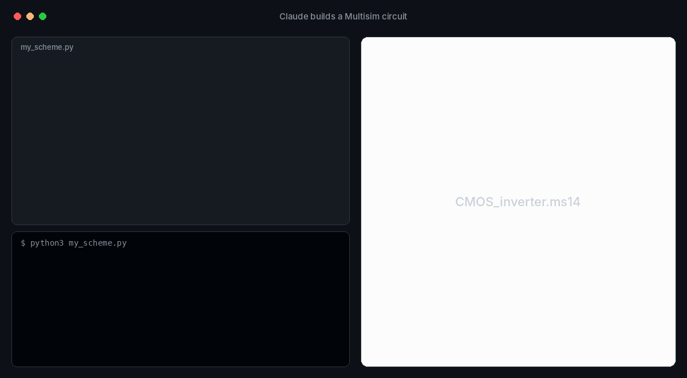
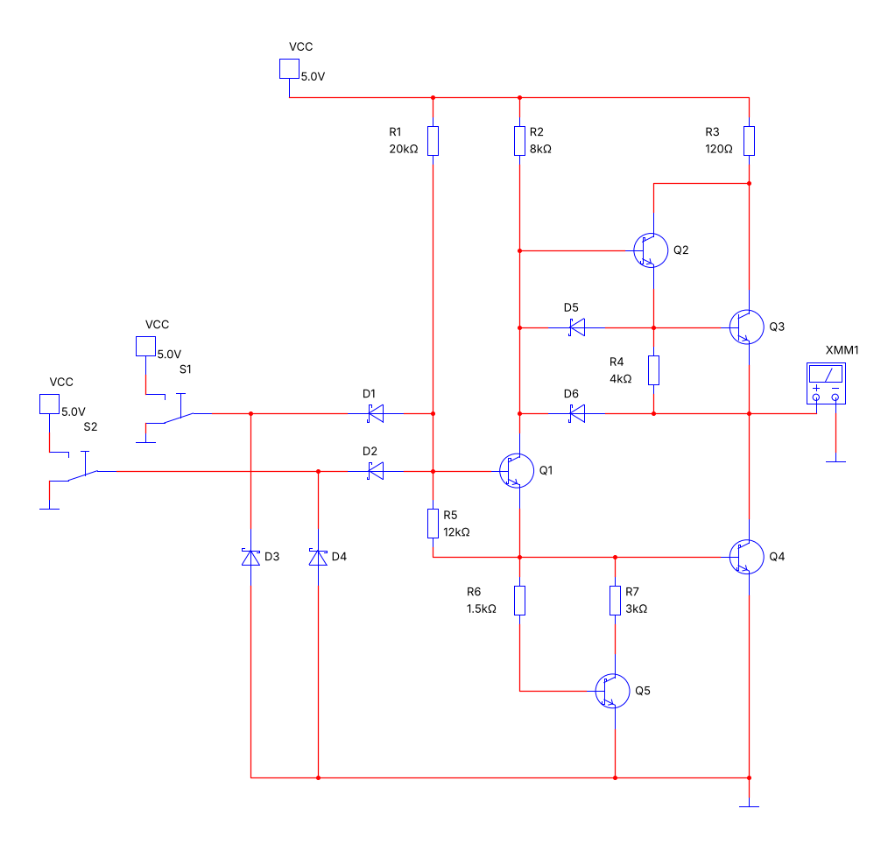
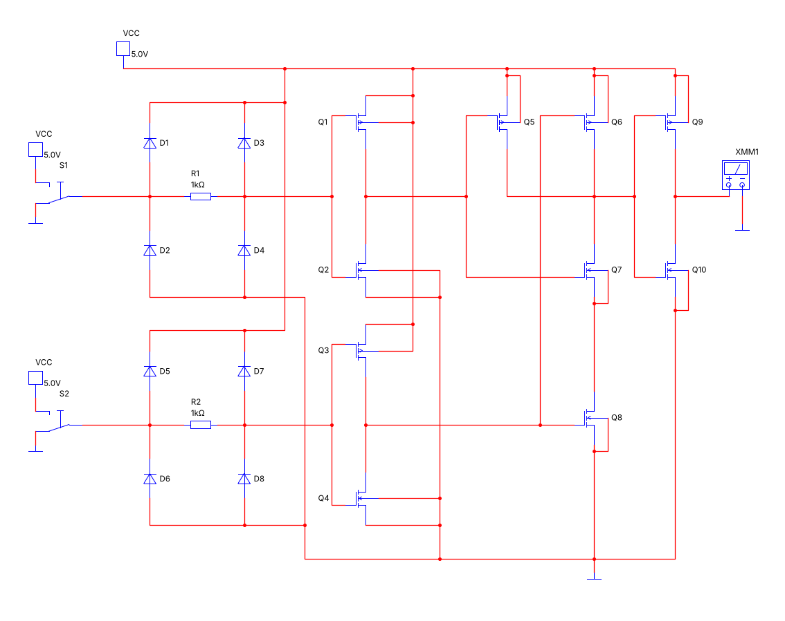

<h1 align="center">Multisim Scheme</h1>

<p align="center"><b>A Claude skill that turns a schematic picture into a native NI Multisim <code>.ms14</code> file.</b><br>
Real Multisim parts · instruments and probes · checked in ngspice before you open it</p>

<p align="center">
  <a href="https://github.com/vovandel155-tech/multisim-schemes/tags"></a>
  
  
  
  <a href="LICENSE"></a>
</p>

<p align="center"></p>

Send Claude a schematic — a screenshot, a textbook figure, an LTspice drawing or just a description — and get back a
native **`.ms14` file** that opens in NI Multisim 14 without a single dialog and simulates right away. The layout
follows the picture: the same element positions, the same wire routing, one common ground bus.

<p align="center">
  
  
</p>

## What it can do

- **Real Multisim parts.** Elements are not synthesized — they are cloned whole (symbol, SPICE model, database record,
  properties dialog) from files saved by Multisim itself. The bundled catalog has **≈250 parts**: transistors, op-amps,
  diodes, LEDs, Darlingtons, logic ICs, timers, sources and instruments.
- **Any missing part on demand.** One double-click on `get_parts.bat` asks your own Multisim (via its COM automation
  API) to place the requested parts and save them; the skill adds them to its catalog. Takes about a second.
- **Instruments and probes:** multimeter, oscilloscope, function generator, Bode plotter, counter, wattmeter…;
  voltage, current, power, digital and differential probes.
- **Special symbols:** Schottky transistors with the textbook «hooks», multi-emitter TTL transistors, MOSFETs with a
  substrate pin — as Multisim subcircuits that look exactly like the figure.
- **A library of ready blocks:** CMOS inverter, 2-input NAND/NOR, CMOS input protection, transistor switch, push-pull
  follower, divider, RC filters, LED with a resistor — one line each, in any of 8 orientations.
- **Checks before you ever open Multisim:** wire overlaps, wires through pins or bodies, label collisions, a PNG
  preview, and an **ngspice** run (truth table for logic, swing and mean for analog circuits).
- **Deterministic builds:** the same script always produces the same file.

## Quick start

### In claude.ai
1. Download [`multisim-scheme.zip`](multisim-scheme.zip).
2. In claude.ai open **Settings → Capabilities → Skills** and upload the zip.
3. Optional but recommended: in the code execution settings allow network access to `raw.githubusercontent.com` —
   the skill then updates itself from this repository at the start of every chat.
4. In a new chat send a schematic and ask: *«Build this circuit in Multisim»*.

### In Claude Code
Clone the repository — the skill lives in `.claude/skills/multisim-scheme/` and is picked up automatically.

### From plain Python
```python
import sys; sys.path.insert(0, '.claude/skills/multisim-scheme/scripts')
from scheme import *

S = Scheme('CMOS_inverter')                       # → output/CMOS_inverter.ms14
inv = S.block('cmos_inv', 20, 14)                 # a ready CMOS inverter block
vdd, g = S.vcc(29, -2), S.gnd(29, 30)
x = S.switch('S1', 10, 14)                        # input switch to VCC/ground
y = S.meter('XMM1', 36, 14)                       # multimeter on the output
S.wires([[x, inv['IN']], [inv['OUT'], y], [vdd, inv['VDD']], [inv['GND'], g]])
S.build()                                         # file + report: nets, overlaps, preview, ngspice
```
The core needs only the Python standard library; `matplotlib` adds the preview and `ngspice` the simulation check.

## How it works

```
picture ─► script (parts on grid cells + wires) ─► build()
                                                  ├─ clone parts from Multisim-saved files (samples/, samples/ni/)
                                                  ├─ wires, junctions, labels, sheet size and centering
                                                  ├─ PKWARE DCL implode → .ms14
                                                  └─ checks: references, overlaps, PNG preview, ngspice
```

The `.ms14` format is a compressed XML document; the skill writes it the same way Multisim does, down to unique GUIDs
per file and per-instrument settings. [`reference.md`](.claude/skills/multisim-scheme/reference.md) documents the
format and the internals; [`SKILL.md`](.claude/skills/multisim-scheme/SKILL.md) is the full manual.

### Getting a part that is not in the catalog
1. Claude writes the part names into `donors_request.txt` (variants allowed: `TIP121|TIP121G`).
2. You close Multisim and double-click `get_parts.bat` (Windows, Multisim 14, Python 3).
3. Multisim places the parts into a template and saves donor files; `harvest.py` cuts each part into a ~4 KB block
   of the catalog. In a git checkout the bat commits and pushes the result; in a chat you send the files back.

## Gallery

[`gallery/`](gallery/) holds 26 verified circuits with their scripts and ready `.ms14` files:
18 classic TTL and CMOS gates (SN7400, SN74LS00, SN74ALS00, CD4001B, CD4011B, MC14016B…) drawn exactly as in a
digital electronics textbook, and demos of catalog parts, instruments, probes and blocks.

## Repository layout

| Path | What is there |
|---|---|
| `.claude/skills/multisim-scheme/` | the skill: `SKILL.md`, `scripts/`, `samples/`, `examples/`, `reference.md` |
| `.claude/skills/multisim-scheme/samples/ni/` | the part catalog: `catalog.json`, `catalog.txt`, `parts.bin` + `parts.idx` |
| `gallery/` | verified circuits: scripts, `.ms14` files, preview images |
| `multisim-scheme.zip` | the skill packed for upload to claude.ai |
| `get_parts.bat` | part extraction from your Multisim (wrapper for the skill's bat) |

## Status and limits

- Verified by hand in **Multisim 14.3** on Windows: every gallery circuit opens without dialogs and its readings match
  ngspice.
- Elements «without a sample» (`SpiceLib`) are experimental — use catalog parts instead;
  [`gallery/experimental/`](gallery/experimental/) keeps an unfinished bridge amplifier for reference.
- Extracting new parts needs Multisim on Windows; building circuits works anywhere Python runs.

## Roadmap

- More blocks: op-amp stages (inverting, non-inverting, integrator), 555 timer modes, flip-flops on gates.
- Probe labels in the overlap check.
- A larger built-in catalog (more ICs and power parts) contributed through `get_parts.bat`.
- Horizontal and multi-section IC layouts verified in Multisim.

## Feedback and contributing

Something did not open, a part is missing, a block would save you time? Open an
[issue](https://github.com/vovandel155-tech/multisim-schemes/issues/new/choose) — there are templates for a missing part
and for a circuit that misbehaves. Pull requests are welcome; see [CONTRIBUTING.md](CONTRIBUTING.md).

If the skill saved you an evening with Multisim, a ⭐ helps other students and engineers find it.

## License

[MIT](LICENSE). NI Multisim is a trademark of National Instruments / Emerson. This project is not affiliated with or
endorsed by NI; part data in the catalog was taken from files saved by Multisim and remains subject to NI's terms.
